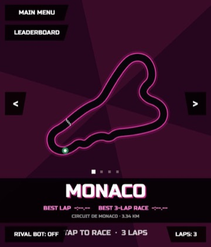
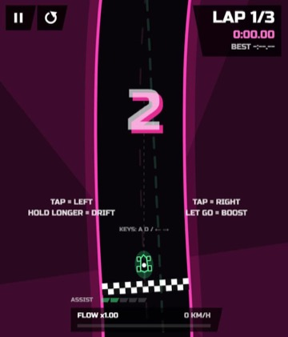

# Neon Gokart

A neon, arcade drift racer for phones. One file of HTML5 canvas (`index.html`), wrapped as a tiny Android app.

**Play in your browser:** https://kimahmet.github.io/neon-gokart/

<p>
  
  
</p>

## Play

- **Left half of the screen:** steer left. **Right half:** steer right. Gas is automatic.
- **Hold one side** to drift. **Let go** to fire a boost; longer drifts give bigger boosts.
- **Ride the racing line** (dashed line) for extra grip. Cut through the **apex** dots to raise your aim assist.
- Brushing a wall costs a little speed. A head-on hit costs more.
- Turn on **RIVAL BOT** (bottom-left of the track screen) to race a bot that drives the ideal line.
- Pause menu: switch between **first-person** and **top-down** view, and pick the sky: **Cyber City**, **Sunset** or **Classic**.

Keyboard: `A` / `D` or arrow keys.

## Run in a browser

Open `index.html`, or serve the folder:

```sh
python3 -m http.server 8080
```

## Build the Android APK

Needs the Android SDK command-line tools (`platforms;android-28`, `build-tools`) and JDK 17. No Gradle.

```sh
cd android
echo '<keystore password>' > .keypass   # or export GK_KEYPASS; .keypass is git-ignored
./build.sh                                # writes android/build/NeonGokart.apk
```

`build.sh` creates `android/neongokart.keystore` on the first run. Keep that file safe and out of git: Android only installs updates signed with the same key.

## Credits

Font: [Russo One](https://fonts.google.com/specimen/Russo+One) by Jovanny Lemonad, SIL Open Font License 1.1 (`android/assets/RussoOne-OFL.txt`).

Track layouts are stylised shapes inspired by real circuits. The circuit names belong to their owners.

## v2.1

Instant restart (no countdown), 1/3/5-lap races, a best-lap ghost, live splits at every apex,
a combo chain (apexes, boosts and close calls without riding a wall raise a multiplier up to x2),
close-call rewards for skimming the wall, a perfect-apex flash, softer steering with a gentle
auto-brake before corners, and procedurally generated synthwave music whose layers build with flow
and pulse the neon on the beat.

`godot/` holds an experimental Godot 4.7 port. It is no longer maintained: the web build in
`index.html` is the game.
